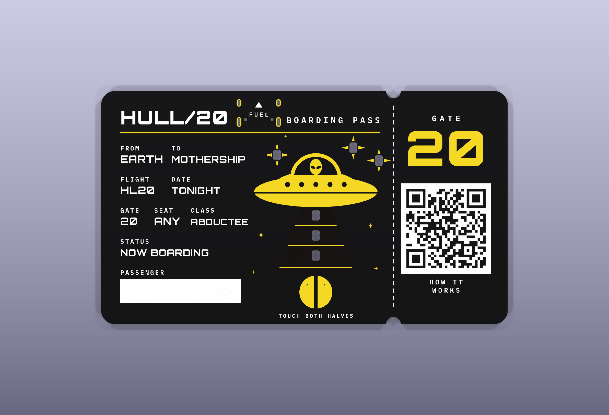
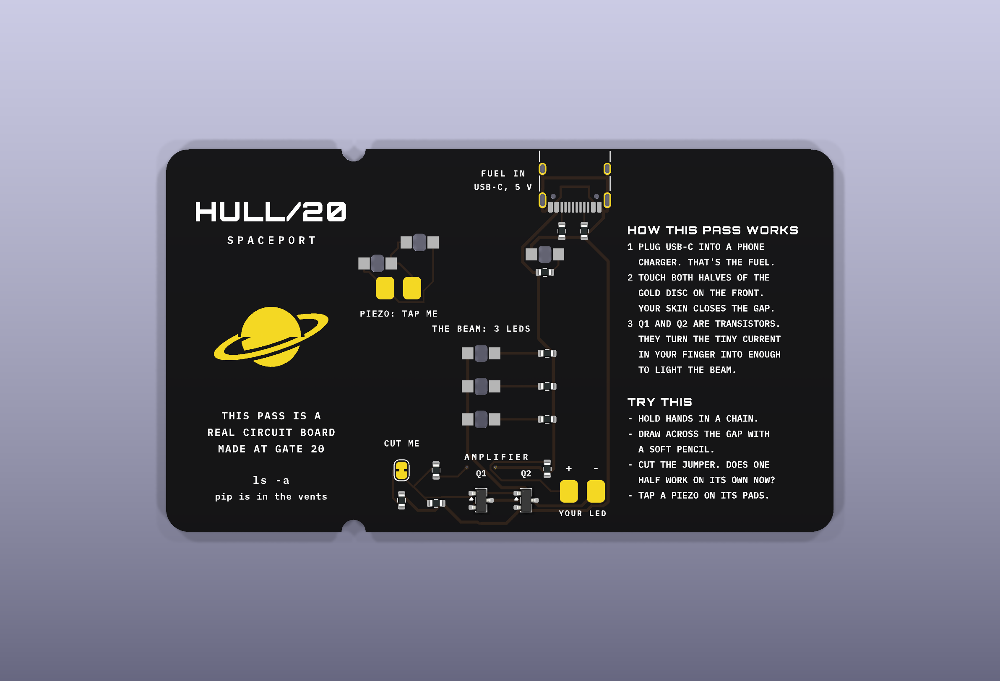

# HULL/20 boarding pass, rev B

A souvenir card that is also a working circuit: 89 x 51 mm, 2 layers, 1.0 mm FR-4, black mask, ENIG gold, white
silkscreen. Touch both halves of the gold disc and the beam lights. No battery, no radio, no firmware.

 

## The circuit

- **USB-C, power only.** CC1/CC2 pulled down with 5.1 kΩ, so any USB-C charger supplies 5 V.
- **The touch switch** is the split gold disc on the front: left half = 5 V, right half = the amplifier's input
  through 100 kΩ.
- **Q1 + Q2 (MMBT3904) as a Darlington pair**, gain about 10,000: the few microamps through a finger, a chain of hands
  or a pencil line switch about 30 mA into three beam LEDs.
- **The beam:** three reverse-mount yellow LEDs (Lite-On LTST-C230KSKT) shine through 1.7 x 2.3 mm cutouts and the
  bare-FR4 beam window, which glows.
- **JP1 "CUT ME":** a bridged solder jumper puts 4.7 MΩ in parallel with the 10 MΩ input pull-down. Cut it and only the
  10 MΩ is left: the input gets twice as touchy (does one half alone now pick up mains hum?).
- **Power star:** one LED behind a star-shaped window, on whenever USB is.
- **Piezo stars (J2):** two LEDs back to back across two pads for a salvaged piezo disc; tap it and a star flashes, no
  USB needed. Not fitted.
- **Spare LED (J3):** two pads with 220 Ω, in parallel with the beam: solder in your own.

Nothing draws current until the disc is closed (the power star aside), so there is no switch. All parts are on the
back, so it assembles one side.

## Files

| Path | What it is |
|---|---|
| `boarding-pass.kicad_pro` / `.kicad_sch` / `.kicad_pcb` / `.kicad_dru` | The KiCad 10 project. Open this to edit. Footprints are embedded in the board |
| `Pass.pretty/` | The custom footprints (project library, `fp-lib-table`) |
| `boarding-pass.ses` | Frozen autorouter session, so a regenerated board gets the same copper |
| `design.py`, `artgen.py`, `rules.kicad_dru` | The generator the board was built from: circuit and placement (`design.py`), every mark of the art as polygons (`artgen.py`). They need a private build toolchain that is **not** part of this release, so treat them as readable source of the design intent; the KiCad files are the editable sources |
| `fab/` | As-ordered manufacturing files: Gerbers + drills (zip), BOM and CPL with LCSC part numbers for PCB assembly, schematic PDF, `SHA256.txt` |
| `renders/` | KiCad 3D renders of the board |

The fab files are the exact set 100 assembled boards were ordered from (October 2026). KiCad DRC on the board: 0
errors, 0 unconnected (KiCad may warn that standard-library footprints and symbols differ from your installed
libraries; those are library-link warnings, not design errors).

The front carries a QR code to the project's public boarding-pass page, `https://spaceport.neighb.io/pass`. Change
`URL` in `artgen.py` (and regenerate) or edit the silkscreen if you make your own.

## Ordering notes

PCB: FR-4, 2 layers, 89 x 51 mm, 1.0 mm, black mask, white silkscreen, ENIG, 1 oz copper, tented vias, no order
number printed on the board. Assembly: bottom side. Not assembled on purpose: J2 (piezo pads), J3 (your-LED pads), JP1
(jumper) and TP1 (the touch disc, which is copper art). Check in the placement preview that each LED's cathode mark
sits on the pad marked K, Q1/Q2 pin 1 matches the silk dot, and the USB-C opening faces the board edge.

Licence: CERN-OHL-P-2.0 (see `../../LICENSES.md`).
